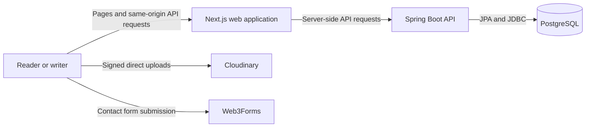
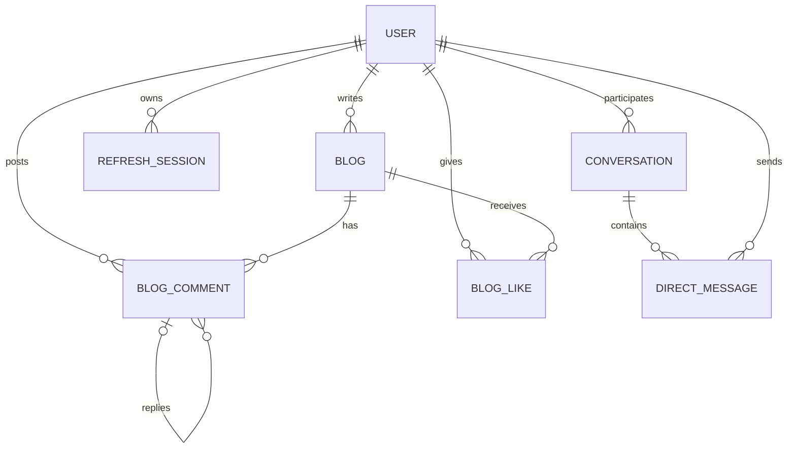

# Drafts

Drafts is a publishing platform for people who want to write, read, and have thoughtful conversations around stories. It brings the public reading experience and the tools writers need into one application: a searchable story library, a rich text editor, author pages, comments, likes, and private messages.

The product is designed around a simple idea: publishing should feel personal, and reading should make it easy to follow an author's work and join the conversation.

## Product experience

### Reading and discovery

Readers can browse published stories, search across story and author details, and choose how the library is ordered. Each story has a dedicated page with its author, publication details, formatted article content, discussion, and like action. Public author pages gather a writer's published stories in one place.

### Writing and publishing

Writers create and edit stories in a shared rich text editor. It supports headings, emphasis, lists, quotations, code blocks, links, and images. Stories can remain drafts until the writer chooses to publish them. The personal stories area brings draft management and publishing controls together.

Article images and profile pictures use Cloudinary. The browser uploads image data directly using a short-lived signature issued by the API, so image files do not pass through or accumulate on the application server.

### Conversation and community

Signed-in readers can like stories, leave comments, and reply to comments. Likes are unique per reader and story. Writers and readers can also start private conversations and continue them from the inbox, with unread message counts and read state.

Account settings cover profile details, credentials, and the profile image. The contact form is a separate visitor-facing path delivered through Web3Forms.

## Application architecture

Drafts is composed of three independently deployable application services and two external integrations:



The Next.js application owns the user interface, server-rendered public pages, and a same-origin `/api` proxy. The proxy forwards requests and authentication cookies to the Spring API. This keeps browser traffic on the website's origin while allowing the API and database to run as separate services.

The Spring Boot application owns identity, publishing rules, data access, conversation workflows, and Cloudinary upload signatures. PostgreSQL stores application records. Cloudinary stores image assets, while Web3Forms handles contact submissions without an application email service.

## Technology

| Layer | Technologies | Role in Drafts |
| --- | --- | --- |
| Web application | Next.js App Router, React, TypeScript | Public pages, interactive writing and reading experiences, server rendering, and API proxy |
| Interface | Tailwind CSS, Lucide React | Responsive visual system, layout, and icons |
| Rich text | React Quill (`react-quill-new`) | Story composition and editing |
| API | Java, Spring Boot, Spring MVC | Application workflows and HTTP API |
| Persistence | Spring Data JPA, Hibernate, PostgreSQL | Relational data and repository access |
| Identity and security | Spring Security, JWT, HttpOnly cookies, CSRF tokens | Authentication, session renewal, and request protection |
| Image delivery | Cloudinary | Profile and story image storage and delivery |
| Contact delivery | Web3Forms | Visitor contact form submissions |
| Hosting integrations | Vercel Analytics and Speed Insights | Frontend usage and performance telemetry |

## Main product areas

| Area | What it provides |
| --- | --- |
| Story library | Paginated published stories, search, sorting, and story cards |
| Story page | Formatted article, author link, likes, comments, replies, and navigation within the current story |
| Author page | Public profile and that author's published stories |
| Writing workspace | Draft creation, editing, image selection, and publication controls |
| Inbox | Private conversations, message history, unread counts, and read state |
| Account settings | Profile image, username, email, and password management |
| Contact page | Validated visitor message form delivered through Web3Forms |

## Data model



Stories belong to their authors and have unique slugs, publication state, timestamps, and like counts. A database uniqueness rule prevents a reader from liking the same story more than once. Comments can reference a parent comment for replies. Conversations connect participants and contain ordered messages. Refresh-session records contain hashes of refresh tokens rather than the raw token values.

## API responsibilities

The backend API is grouped by product domain:

- **Authentication:** registration, sign-in, sign-out, current account lookup, CSRF token issuance, and refresh-session rotation.
- **Stories:** public search and discovery, author listings, personal story management, publishing, and deletion.
- **Engagement:** comment and reply retrieval and creation, plus per-reader story likes.
- **Users:** public profile lookup and authenticated account updates.
- **Messaging:** conversation creation, message history, sending, unread counts, and read state.
- **Uploads:** short-lived Cloudinary signature generation for authenticated users.

The frontend normally reaches these capabilities through its same-origin proxy. The backend also exposes an OpenAPI description and a health endpoint for its hosting environment.

## Identity and application security

Drafts keeps authentication tokens out of browser storage. The access token is held in an HttpOnly cookie, and a separate HttpOnly refresh cookie is rotated when a session is renewed. Refresh-session token hashes are stored server-side so a session can be revoked without retaining its bearer value.

Mutating requests use a CSRF cookie and matching request header. The frontend proxy validates the request origin and CSRF values before forwarding writes. The API uses Spring Security for authentication and authorization, BCrypt for passwords, and explicit ownership checks for private stories and conversations. The frontend applies browser security headers, and the backend validates request payloads at the API boundary.

Cloudinary signing credentials remain on the backend. Only the signed upload parameters needed for a short-lived browser upload are returned to the client. Contact form delivery is handled by Web3Forms; it does not give the frontend access to application credentials.

## Repository map

```text
Drafts/
├── backend/
│   ├── src/main/java/com/drafts/backend/
│   │   ├── auth/        Authentication and refresh sessions
│   │   ├── blog/        Stories, search, likes, and discussion
│   │   ├── config/      Security, API behavior, and application configuration
│   │   ├── messaging/   Conversations and direct messages
│   │   ├── upload/      Cloudinary upload signatures
│   │   └── user/        Profiles and account management
│   └── src/main/resources/
└── frontend/
    ├── src/app/         Public pages, account areas, and API proxy
    ├── src/components/  Shared interface and story interactions
    ├── src/lib/         API, session, and metadata helpers
    ├── src/types/       Shared frontend data shapes
    └── public/          Brand and site assets
```

## Project character

Drafts combines publishing, discovery, and conversation in one cohesive product. Its architecture keeps the reading experience fast and public-facing while placing private actions behind authenticated API workflows. Writers retain control over when a story becomes public, and readers can engage with published work without losing the focus on the writing itself.

Built by Aryan Sharma.
